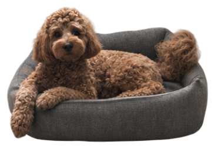

# Собака на столе

Настольный питомец для macOS 13 и новее. Готовая сборка для Mac с Apple Silicon
доступна в [GitHub Releases](https://github.com/DDDinar/desktop-dog/releases/latest).
Распакуйте архив и откройте **Собака на столе.app**.

Собака отдыхает в лежанке за обычными окнами и не перехватывает клики. Сверните окна, чтобы
её увидеть, или включите **Поверх окон** через значок лапки в строке меню.
Там же можно поменять размер, спрятать собаку, уложить её или разбудить.
В режиме лежанки собака время от времени встаёт, виляет хвостом, нюхает край
лежанки и снова укладывается. Команды **Погладить** и **Понюхать лежанку**
запускают эти действия сразу. Снимите галочку **Режим лежанки** в меню лапки,
чтобы она могла гулять по столу.

- После двух минут без ввода собака засыпает. При следующем вводе она просыпается.
- Собака иногда обнюхивает папки на рабочем столе. Команда **Обнюхать папку**
  отправляет её на поиски сразу. Она использует сохранённые Finder позиции
  видимых папок. Для только что добавленного значка Finder может ещё не
  сохранить позицию. Если macOS запрашивает доступ к рабочему столу, он
  нужен для этой функции. Содержимое папок приложение не открывает.
- Собака может ненадолго побежать за движущимся курсором. Через лапку можно
  отключить спонтанные погони или сразу выбрать **Догонять курсор**.
  Если на пути есть значок папки и за ним достаточно места, собака
  перепрыгивает значок и продолжает погоню.

Пункт **Запускать при входе** в меню лапки управляет автозапуском. Галочка
означает, что macOS откроет приложение при следующем входе в учётную запись.

## Сборка из исходников

На Mac с инструментами командной строки Xcode запустите `./build.sh`
из корня репозитория. Скрипт собирает приложение для архитектуры текущего Mac
и сохраняет его рядом с папкой репозитория. Сборка подписана локальной подписью
и не проходила нотариальную проверку Apple.

Собака отображается цельными фотореалистичными кадрами, созданными по
фотографиям. Ходьба использует пять ракурсов и отражения для
восьми направлений. Кадр шага выбирается по пройденному пути. Для рыси
сбоку, прыжка и виляния хвостом есть свои кадры; для сна, отдыха и
обнюхивания — отдельные позы.

`Assets/Photo/Motion/Atlas.json` задаёт границы кадров, точки опоры и
единый масштаб каждого ракурса. После замены листов его можно пересоздать
командой `python3 Tools/register_motion.py` (требуется Pillow).
