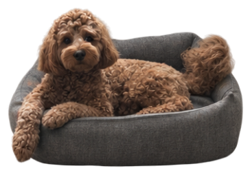

# Собака на столе

Настольный питомец для macOS 13 и новее. Готовая сборка для Mac с Apple Silicon
доступна в [GitHub Releases](https://github.com/DDDinar/desktop-dog/releases/latest).
Распакуйте архив и откройте **Собака на столе.app**.

Собака видна на свободной части рабочего стола и не перехватывает клики.
Покажите рабочий стол, чтобы увидеть её, если она оказалась за окном.
Там же можно поменять размер, спрятать собаку, уложить её или разбудить.
В режиме лежанки собака время от времени встаёт, виляет хвостом, нюхает край
лежанки и снова укладывается. Команды **Погладить** и **Понюхать лежанку**
запускают эти действия сразу. Снимите галочку **Режим лежанки** в меню лапки,
чтобы она могла гулять по столу.

- После двух минут без ввода собака засыпает. При следующем вводе она просыпается.
- Собака иногда обнюхивает папки на рабочем столе. Команда **Обнюхать папку**
  отправляет её на поиски сразу. Она использует сохранённые Finder позиции
  видимых папок. Для только что добавленного значка Finder может ещё не
  сохранить позицию. Если macOS запрашивает доступ к рабочему столу, он
  нужен для этой функции. Содержимое папок приложение не открывает.
- Собака может ненадолго побежать за движущимся курсором. Через лапку можно
  отключить спонтанные погони или сразу выбрать **Догонять курсор**.
  Если на пути есть значок папки и за ним достаточно места, собака
  перепрыгивает значок и продолжает погоню.

На прогулке пёс иногда делает остановку, чтобы пописать или покакать. Оба действия
можно вызвать сразу через меню лапки — **Пописать** или **Покакать**.
[Видео обеих анимаций](./На%20прогулке.mp4).

В режиме лежанки пёс также может зевнуть или наклонить голову, прислушиваясь.
Эти действия иногда происходят сами. В меню лапки их можно вызвать командами
**Позевать** и **Прислушаться**.

Пункт **Запускать при входе** в меню лапки управляет автозапуском. Галочка
означает, что macOS откроет приложение при следующем входе в учётную запись.

## Сборка из исходников

На Mac с инструментами командной строки Xcode запустите `./build.sh`
из корня репозитория. Скрипт собирает приложение для архитектуры текущего Mac
и сохраняет его рядом с папкой репозитория. Сборка подписана локальной подписью
и не проходила нотариальную проверку Apple.

Для ходьбы и разворотов используются девять фотографических ракурсов, созданных
по фотографиям пса. Вместе с отражениями они дают 16 направлений. В полном
цикле ходьбы 48 кадров на ракурс. Фаза зависит от пройденного расстояния;
для разгона и торможения заготовлены укороченные шаги. Перед разворотом пёс
замедляется и поочерёдно переставляет лапы. Для рыси сбоку, прыжка и виляния
хвостом есть отдельные серии кадров.

[Посмотреть ходьбу и разворот в движении](./Ходьба%20и%20разворот.mp4) · [GIF с разворотом](./Поворот.gif)

Границы кадров и точки опоры хранятся в `Assets/Photo/Motion/Atlas.json`.
После изменения исходных фотографий запустите `python3 Tools/register_motion.py`,
затем `python3 Tools/bake_walk.py` для пересоздания кадров шага и `Walk.json`
(требуются Pillow и NumPy). Готовые кадры входят в репозиторий.

Промежуточные позы строятся по картам движения в `Flow.rgba`. Чтобы обновить
карты после смены кадров, соберите приложение и выполните из корня репозитория
`swift Tools/motion_flow.swift "../Собака на столе.app/Contents/Resources/Photo/Motion/Bed.png"`,
затем снова запустите `./build.sh`.
